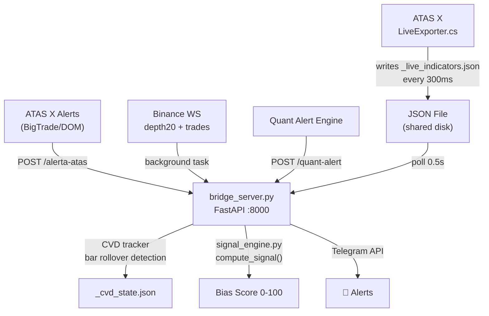

# 🔬 ATAS Bridge — Full Quant / Engineering Audit

**Auditor perspective:** Quant Researcher · ML Engineer · Algorithmic Crypto Trading Expert  
**Date:** 2026-08-05  
**Codebase version:** bridge_server v3.1.0 / rules.json v3.2  
**Files reviewed:** 15 core files, ~2500 LOC Python + 238 LOC C#

---

## Executive Summary

This is a **real-time order-flow analysis bridge** connecting ATAS X (professional trading platform) to a Python backend that fuses footprint data, DOM snapshots, Binance WebSocket feeds, and a custom CVD tracker to produce quantitative bias scores delivered via Telegram.

**Verdict: Solid prototype-grade system with genuinely good engineering instincts** (atomic writes, corruption guards, sequence validation). However, it has **critical gaps** that would cause real money losses in production: hardcoded secrets in source, a signal engine that can't distinguish real signals from noise at the current sample size, and several subtle data integrity issues.

---

## 1. Architecture Assessment



### What's Good

| Aspect | Assessment |
|--------|-----------|
| **Data fusion** | Genuinely multi-source: ATAS footprint + DOM + Binance WS depth + trade flow + CVD. This is more comprehensive than most retail algo setups. |
| **CVD corruption guards** | TIME GATE, PHYSICAL GATE, JUMP GATE — these protect against chart reload replay, impossible delta values, and missed bars. Evidence of hard-won debugging. |
| **Atomic file writes** | Both C# (`File.Move` overwrite) and Python (`os.replace` via tmp) use atomic rename. Prevents half-written JSON corruption. |
| **Sequence validation** | Binance WS depth uses `pu` field to detect gaps and resyncs from REST snapshot. Professional-grade. |
| **DOM persistence filter** | `DOM_PERSIST_REQUIRED = 3` — walls must persist across 3 consecutive reads to be flagged. Filters spoofed walls. |
| **Signal engine separation** | `signal_engine.py` is pure-functional, deterministic, no I/O. Textbook design for testability. |

### What's Concerning

| Aspect | Risk | Severity |
|--------|------|----------|
| **Monolithic server** | 1651-line single file with mixed concerns (Telegram, DOM, CVD, analysis, parsing, auth). Hard to test in isolation. | 🟡 Medium |
| **File-based IPC** | ATAS → bridge communication via `_live_indicators.json` polled at 0.5s. Race conditions possible if ATAS writes faster than bridge reads. | 🟡 Medium |
| **No message queue** | ATAS alerts arrive via HTTP webhook with no retry/persistence. If bridge is down, alerts are lost forever. | 🟡 Medium |
| **Single process** | No horizontal scaling, no failover. Bridge crash = total blindness. | 🟡 Medium |

---

## 2. 🚨 CRITICAL: Security Vulnerabilities

> [!CAUTION]
> ### Hardcoded Secrets in Source Code

Multiple files contain **plaintext API tokens** committed to the repository:

| File | Line | Secret |
|------|------|--------|
| [`_integrated_analysis.py`](file:///c:/atas-bridge/_integrated_analysis.py#L21-L22) | 21-22 | `TELEGRAM_TOKEN = "8890755562:AAH..."` hardcoded as fallback |
| [`_integrated_analysis.py`](file:///c:/atas-bridge/_integrated_analysis.py#L170-L172) | 170-172 | Full bot token hardcoded in URL string |
| [`binance_dom.py`](file:///c:/atas-bridge/binance_dom.py#L29) | 29 | `TELEGRAM_BOT = "8890755562:AAH..."` |
| [`bridge_server.py`](file:///c:/atas-bridge/bridge_server.py#L62) | 62 | `TELEGRAM_CHAT_ID` default `"6369690844"` |

**Impact:** Anyone with repo access can impersonate your Telegram bot, read your messages, or spam your chat. The bot token should be **rotated immediately** and moved to `.env` only.

> [!CAUTION]
> ### Auth Bypass When BRIDGE_TOKEN Is Empty

[`bridge_server.py:747-748`](file:///c:/atas-bridge/bridge_server.py#L747-L748):
```python
if not BRIDGE_TOKEN:
    return  # no token configured, allow all
```

All POST endpoints (`/analizar`, `/reset`, `/quant-alert`, `/alerta-atas`) are **unauthenticated** when `BRIDGE_TOKEN` is unset. Any process on the machine (or network, if `HOST` is changed from `127.0.0.1`) can inject fake alerts, trigger analyses, or clear buffers.

---

## 3. Signal Engine Audit ([`signal_engine.py`](file:///c:/atas-bridge/signal_engine.py))

### 3.1 Scoring Architecture

```
bias_score = Σ(sub_score_i × weight_i) / Σ(weight_i) × 10.0
```

| Sub-Score | Weight | Range | Assessment |
|-----------|--------|-------|------------|
| `footprint_depth` | 25 | 0-10 | ✅ Clean linear ratio of buy/sell levels |
| `dom_imbalance` | 25 | 0-10 | ⚠️ Linear mapping caps at ±20% imbalance — too sensitive for crypto |
| `tape_ratio` | 20 | 0-10 | ⚠️ Uses count-based `buy_count_pct`, ignoring volume weighting |
| `volume_climax` | 15 | 0-10 | ❌ **Hardcoded absolute thresholds** (50K, 200K, 500K) — meaningless across different assets |
| `footprint_confirmation` | 15 | 5 or 10 | ❌ **Binary jump** — 2+ levels = 10.0, else 5.0. No granularity. |

### 3.2 Critical Scoring Flaws

> [!WARNING]
> #### Volume Climax Uses Absolute Thresholds

[`signal_engine.py:134-143`](file:///c:/atas-bridge/signal_engine.py#L134-L143): The `_score_volume_climax` function uses hardcoded volume tiers (`>500K`, `>200K`, etc.) that are **meaningless across assets**. SUIUSDT at $0.69 has vastly different volume profiles than BTCUSDT at $100K+. This should use:
- Rolling Z-score of volume (e.g., vol vs 20-bar SMA)
- Volume relative to ADV (average daily volume)
- Asset-specific percentile ranking

> [!WARNING]
> #### Tape Ratio Ignores Volume Weighting

[`signal_engine.py:118-121`](file:///c:/atas-bridge/signal_engine.py#L118-L121): `tape_buy_count_pct` counts **number of trades**, not volume. In the live data snapshot, `buy_count_pct = 63%` looks bullish, but `sell_vol = 17,345 SUI` vs `buy_vol = 1,287 SUI` — sells dominate by **13.5x volume**. This is a textbook trap: many small buys vs few whale sells. A proper tape score should weight by trade size.

> [!WARNING]
> #### Footprint Confirmation Is Binary

[`signal_engine.py:146-150`](file:///c:/atas-bridge/signal_engine.py#L146-L150): Returns exactly 5.0 or 10.0. With weight 15, this creates a ±7.5 point swing on a 0-100 scale from having 1 vs 2 footprint levels. Should be proportional.

### 3.3 Rule Implementation Issues

#### Rule 6 (Distribution) — Inverted Selling Logic

[`signal_engine.py:196`](file:///c:/atas-bridge/signal_engine.py#L196):
```python
if total_level_vol > 0 and bid_vol / total_level_vol >= 0.70:
    sell_dominated += 1
```

The comment says "4 levels 70%+ selling" but the code checks `bid_vol / total_level_vol >= 0.70`. In ATAS footprint conventions:
- **Bid volume** = volume traded at the bid = **passive selling** (market sells hitting resting bids)
- **Ask volume** = volume traded at the ask = **passive buying**

So `bid_vol >= 70%` actually means **70%+ of volume is hitting the bid** = selling pressure. The logic is **correct** but the variable naming is confusing and the docstring is misleading. This will cause maintenance bugs.

#### Rule 7 (Accumulation) — Same Issue

[`signal_engine.py:218`](file:///c:/atas-bridge/signal_engine.py#L218): Checks `ask_vol / total_level_vol >= 0.70` for buying — again correct but naming/docs mismatch.

#### Rule 2 (Exhaustion) — Missing Directionality

[`signal_engine.py:174-180`](file:///c:/atas-bridge/signal_engine.py#L174-L180): Checks absolute value only (`abs(cvd_bar_deltas[-1])`). A massive +100K delta followed by a +250K delta triggers exhaustion — but this is continuation, not exhaustion. The rule should only flag exhaustion when the spike is **in the same direction as the existing trend**, or when it's a blow-off top/bottom.

### 3.4 Weight System Doesn't Match `rules.json`

[`signal_engine.py:240-241`](file:///c:/atas-bridge/signal_engine.py#L240-L241): The signal engine uses 5 sub-scores: `footprint_depth`, `dom_imbalance`, `tape_ratio`, `volume_climax`, `footprint_confirmation`. But `rules.json` weights have `multi_bar_confirmation: 15` as a key, while the code uses `footprint_confirmation`. The mismatch means the last sub-score always picks up the **default weight of 5** from `weights.get(k, 5)` instead of 15.

---

## 4. CVD Tracker Audit ([`bridge_server.py:497-741`](file:///c:/atas-bridge/bridge_server.py#L497-L741))

### What's Well Engineered

The CVD tracker has **three corruption gates** that show evidence of real production debugging:

1. **TIME GATE** (`_CVD_MIN_BAR_SECONDS = 20s`): Bars advancing faster than 20s = history backfill replay → segment reset
2. **PHYSICAL GATE** (`|delta| > volume × 1.1 + 1.0`): Impossible delta values rejected
3. **JUMP GATE** (`bar_index - prev > 1`): Missed bars → segment reset

### Issues

| Issue | Location | Detail |
|-------|----------|--------|
| **Thread/async mixing** | [L473-474](file:///c:/atas-bridge/bridge_server.py#L473-L474) | Uses `threading.Lock` for `_CVD_LOCK` inside `async` context. While `_CVD_LOCK` is only acquired in `run_in_executor` calls (correct), `_cvd_process_live()` at [L606](file:///c:/atas-bridge/bridge_server.py#L606) is called from `_cvd_tracker()` which runs in an executor. If any async code path ever calls `_cvd_process_live` directly, it will deadlock the event loop. |
| **No bar delta normalization** | [L694](file:///c:/atas-bridge/bridge_server.py#L694) | `bar_deltas` stores raw delta values. SUI deltas are 5-digit (±100K), SOL deltas are 4-digit (±50K). Cross-asset comparison is impossible. Should normalize by volume or notional. |
| **Segment counter only** | [L534](file:///c:/atas-bridge/bridge_server.py#L534) | `segments` counts resets but doesn't track **when** or **why**. During a volatile session, you can't post-mortem which resets were legitimate vs bugs. |
| **CVD window too small** | [L506](file:///c:/atas-bridge/bridge_server.py#L506) | `_CVD_MAX_BAR_DELTAS = 48` on 5-minute bars = 4 hours of history. Insufficient for session-level trend analysis. |

---

## 5. WebSocket Feed Audit ([`bridge_server.py:112-320`](file:///c:/atas-bridge/bridge_server.py#L112-L320))

### Good: Sequence Gap Detection

[L196-209](file:///c:/atas-bridge/bridge_server.py#L196-L209): Checks `pu != last_update_id` to detect sequence gaps in depth updates, resyncs from REST. This is **correct Binance protocol implementation**.

### Good: Heartbeat Monitoring

[L306-312](file:///c:/atas-bridge/bridge_server.py#L306-L312): Detects stale feeds (no message for 30s) and forces reconnect.

### Issues

| Issue | Severity | Detail |
|-------|----------|--------|
| **Silent exception swallowing** | 🔴 High | [L264](file:///c:/atas-bridge/bridge_server.py#L264): `except Exception: pass` in depth processing. Parse errors, type errors, key errors — all silently dropped. You could be running on stale data for hours without knowing. |
| **Silent exception swallowing** | 🔴 High | [L303](file:///c:/atas-bridge/bridge_server.py#L303): Same in trade processing. |
| **No feed health metrics** | 🟡 Medium | No counters for messages/second, reconnects, gaps detected. Can't tell if feed quality is degrading. |
| **Trade summary window too short** | 🟡 Medium | [L117](file:///c:/atas-bridge/bridge_server.py#L117): `TRADE_SUMMARY_WINDOW = 10` seconds. On thin alts this captures 0-5 trades — statistically meaningless. |
| **Hardcoded symbol list** | 🟡 Medium | [L128](file:///c:/atas-bridge/bridge_server.py#L128): `symbols = ["solusdt", "suiusdt", ...]` — adding a symbol requires code change and restart. |

---

## 6. LiveExporter (C#) Audit ([`LiveExporter.cs`](file:///c:/atas-bridge/atas-exporter/LiveExporter.cs))

### Good Design Decisions

- **Current-bar-only export** ([L60](file:///c:/atas-bridge/atas-exporter/LiveExporter.cs#L60)): `if (bar != CurrentBar - 1) return;` prevents historical replay from corrupting live state. Critical for CVD tracker integrity.
- **300ms throttle** ([L64](file:///c:/atas-bridge/atas-exporter/LiveExporter.cs#L64)): Prevents excessive I/O.
- **Atomic write** ([L226-228](file:///c:/atas-bridge/atas-exporter/LiveExporter.cs#L226-L228)): Write to `.tmp`, then `File.Move` overwrite.

### Issues

| Issue | Severity | Detail |
|-------|----------|--------|
| **Tape buffer not bar-scoped** | 🔴 High | `_tapeBuffer` accumulates trades globally via `OnNewTrade`, not per-bar. After a few minutes, the tape snapshot contains trades from multiple bars, diluting the current bar's signal. Should clear on bar change. |
| **No flush on bar close** | 🟡 Medium | When a bar closes, the last snapshot written may be from 0-300ms before close. The CVD tracker uses "last observed delta" as the closed bar's final delta — this is accurate within one write cycle but can miss a large trade in the final 300ms. |
| **POC calculation incorrect** | 🟡 Medium | [L85](file:///c:/atas-bridge/atas-exporter/LiveExporter.cs#L85): POC is `sortedByVol.FirstOrDefault()?.Price` — the highest-volume level. This is correct by definition (Point of Control = highest volume price). ✅ |
| **Hardcoded file path** | 🟡 Medium | [L15](file:///c:/atas-bridge/atas-exporter/LiveExporter.cs#L15): `C:\atas-bridge\_live_indicators.json`. Not configurable. |

---

## 7. Validation Framework Audit ([`_validate_rules.py`](file:///c:/atas-bridge/_validate_rules.py))

> [!IMPORTANT]
> ### The Backtest Is Fundamentally Flawed

[`_validate_rules.py:24-36`](file:///c:/atas-bridge/_validate_rules.py#L24-L36): `_build_partial_snapshot()` constructs a `Snapshot` with:
- `delta = 0`
- `volume_total = 0`
- `volume_bid = 0`, `volume_ask = 0`
- `footprint_levels = []`
- `dom_imbalance_pct = 0`
- All CVD fields default to 0

This means **every single audit entry** will compute to `bias_score ≈ 50` (neutral), `trade_plan_allowed = False`, `rule_6 = False`, `rule_7 = False`. The backtest is validating against **phantom data**, not the actual market state at the time of each call. It will always report that losses would have been "BLOCKED" by Rule 10 (neutral zone), which is trivially true when all inputs are zero.

**Fix:** The audit log needs to capture the full `Snapshot` fields at call time, not just price and CVD.

---

## 8. Audit Log & Track Record Analysis

### Sample Size Problem

| Metric | Value | Assessment |
|--------|-------|------------|
| Total calls | 11 | **Far too few** for any statistical conclusion |
| Wins | 6 | |
| Losses | 5 | |
| Win rate | 54.5% | |
| 95% CI (Wilson) | [28%, 79%] | **Interval spans random coin flip** |
| Required for p<0.05 | ~200+ calls | At 60% true WR, need n≈200 for CI to exclude 50% |

### Summary field says `total: 11` but audit log has 10 entries

[`audit.log.json:105`](file:///c:/atas-bridge/audit.log.json#L105): `"total": 11` but only 10 entries exist in `audit_log[]`. Off-by-one error.

### All calls are on SUIUSDT only

Despite Rule 9 mandating "Asset Independence" and the system tracking SOL, SUI, HYPE, XRP, BTC, ETH, etc., every single audit entry is SUIUSDT. No cross-asset validation exists.

### Failure Mode Analysis

| Failure | Count | Rules Violated |
|---------|-------|----------------|
| Single-bar prediction | 3/5 losses | Rule 1 |
| CVD exhaustion ignored | 1/5 losses | Rule 2 |
| Pattern anchoring | 2/5 losses | Rule 5 |
| Incomplete distribution call | 2/5 losses | Rule 6 |

The pattern is clear: **the agent over-trades in conviction spikes**. Rules 1, 2, 5, 6 were designed to prevent this, but the signal engine's neutral zone (40-59) is the only actual gate, and it triggers on data, not behavioral patterns.

---

## 9. Data Integrity Issues

### Duplicate `_read_live_data` Functions

[`bridge_server.py:753`](file:///c:/atas-bridge/bridge_server.py#L753) and [`bridge_server.py:822`](file:///c:/atas-bridge/bridge_server.py#L822) define `_read_live_data()` (async-compatible) and `_read_live_data_sync()` (executor-safe) respectively. They are near-identical but maintained separately — a refactoring bug waiting to happen.

### `_live_indicators.json` Read Not Thread-Safe

[`bridge_server.py:757-758`](file:///c:/atas-bridge/bridge_server.py#L757-L758): `open() → read() → json.loads()` without any file locking. While the C# writer uses atomic rename, the Python reader could still get an empty file between the `os.replace()` and the next OS flush. On Windows, `File.Move` is not truly atomic in all filesystems (NTFS guarantees it, but ReFS and network drives do not).

### `_normalize_number` Edge Cases

[`bridge_server.py:965-1007`](file:///c:/atas-bridge/bridge_server.py#L965-L1007): The European/US number format detector is clever but has edge cases:
- `"12,345"` → treated as European decimal `12.345` (correct for crypto prices but wrong for lot sizes)
- `"1,2345"` → falls through to European decimal → `1.2345`
- Empty string, `None`, or non-numeric strings not fully guarded

---

## 10. Dependency & Operational Risks

### Missing from requirements.txt

[`requirements.txt`](file:///c:/atas-bridge/requirements.txt) lists only `fastapi`, `uvicorn`, `pydantic`. Missing:
- `websockets` (used for Binance feeds, optional-imported with `HAS_WEBSOCKETS`)

### Log File Growth

[`bridge_server.py:76`](file:///c:/atas-bridge/bridge_server.py#L76): `bridge_debug.log` uses `filemode="a"` (append forever). Current size: **50MB**. No rotation configured. Will eventually fill disk.

[`bridge_server.py:471`](file:///c:/atas-bridge/bridge_server.py#L471): `_tick_history.jsonl` also append-only. Current size: 65KB but growing unbounded.

### `log` Referenced Before Definition

[`bridge_server.py:51`](file:///c:/atas-bridge/bridge_server.py#L51): `log.warning("websockets not installed...")` is called inside the `except ImportError` block, but `log` is defined on line 79. If `websockets` is not installed, this will crash with `NameError: name 'log' is not defined`.

### Deprecated FastAPI Event Hook

[`bridge_server.py:91`](file:///c:/atas-bridge/bridge_server.py#L91): `@app.on_event("startup")` is deprecated since FastAPI 0.93. Should use `@app.lifespan`.

---

## 11. Quantitative Strategy Critique

### The Fundamental Problem: Score ≠ Signal

The signal engine outputs a **bias score** (0-100) but has **no edge**. A bias score tells you "conditions look bullish" but not:
- **Expected return** per signal
- **Sharpe ratio** of the signal
- **Maximum drawdown** under the signal
- **Holding period** for the signal
- **Position sizing** based on confidence

Without these, the score is a **sentiment meter**, not a trading signal. Professional quant systems output:
1. **Direction** (long/short)
2. **Confidence** (calibrated probability)
3. **Size** (Kelly/fractional Kelly)
4. **Entry** (limit/market, price level)
5. **Exit** (stop-loss, take-profit, time-based)

### No Proper Backtesting Infrastructure

- `_tick_history.jsonl` captures tick data but there's **no replay engine**
- No walk-forward optimization
- No out-of-sample testing
- No transaction cost modeling
- No slippage modeling

### The Scoring Weights Are Not Calibrated

The weights in `rules.json` (`footprint_depth: 25, dom_imbalance: 25, tape_ratio: 20, volume_climax: 15, footprint_confirmation: 15`) appear to be **hand-tuned intuitions**, not optimized against historical outcomes. With only 11 calls in the audit log, there's no dataset to calibrate against.

---

## 12. Recommendations — Priority Ordered

### P0: Immediate (do today)

| # | Action | Why |
|---|--------|-----|
| 1 | **Rotate Telegram bot token** and remove all hardcoded secrets from source | Active credential leak |
| 2 | **Fix `log` reference before definition** at line 51 | Crash on startup if websockets not installed |
| 3 | **Fix weight key mismatch** (`multi_bar_confirmation` → `footprint_confirmation` in rules.json) | Silent scoring error |
| 4 | **Fix audit log count** (says 11, has 10) | Data integrity |

### P1: This week

| # | Action | Why |
|---|--------|-----|
| 5 | **Replace silent `except: pass`** in WS handlers with proper error logging + counters | Flying blind on data quality |
| 6 | **Make volume climax scoring relative** (Z-score or percentile vs rolling window) | Current thresholds are meaningless cross-asset |
| 7 | **Weight tape_ratio by volume**, not count | Count ratio is misleading (many small buys ≠ bullish) |
| 8 | **Add log rotation** (use `RotatingFileHandler`, 10MB × 5 files) | 50MB log file growing unbounded |
| 9 | **Clear tape buffer on bar change** in LiveExporter.cs | Stale cross-bar trades dilute signal |

### P2: This month

| # | Action | Why |
|---|--------|-----|
| 10 | **Build a proper backtest replay engine** from `_tick_history.jsonl` | Currently no way to validate any strategy change |
| 11 | **Capture full Snapshot in audit log** at call time | Current backtest validator is useless with zero-filled fields |
| 12 | **Add feed health metrics** (messages/sec, reconnects, gaps, latency) | Need observability before trusting signals |
| 13 | **Make symbol list configurable** via env var or config file | Code change + restart to add a symbol is unacceptable |
| 14 | **Migrate to FastAPI lifespan** pattern | Deprecated `on_event("startup")` |

### P3: Before going live with real capital

| # | Action | Why |
|---|--------|-----|
| 15 | **Build proper PnL attribution** — expected return, Sharpe, max DD per signal | Score without edge metrics is a sentiment meter |
| 16 | **Implement walk-forward optimization** for scoring weights | Hand-tuned weights on 11 samples = overfitting guarantee |
| 17 | **Add transaction cost + slippage model** | Edge evaporates when you account for spread + impact |
| 18 | **Implement position sizing** (Kelly or fractional Kelly) | Without sizing, even a positive-edge signal can blow up |
| 19 | **Split bridge_server.py** into modules (ws_feeds, cvd_tracker, analysis, telegram, endpoints) | 1651 lines in one file is unmaintainable |

---

## 13. Severity Summary

| Category | Critical 🔴 | High 🟠 | Medium 🟡 | Low 🟢 |
|----------|-------------|---------|-----------|--------|
| Security | 2 | 0 | 0 | 0 |
| Data Integrity | 1 | 2 | 3 | 1 |
| Signal Quality | 0 | 3 | 2 | 0 |
| Operations | 1 | 1 | 3 | 2 |
| **Total** | **4** | **6** | **8** | **3** |

---

## 14. What's Genuinely Good (Credit Where Due)

1. **The CVD corruption guards are production-quality.** The TIME/PHYSICAL/JUMP gate pattern shows real debugging maturity — someone got burned by chart replay poison and fixed it properly.

2. **`signal_engine.py` is architecturally correct** — pure function, typed inputs, typed outputs, no side effects. This is the right foundation to build on.

3. **The rules.json framework is honest.** The audit log documents real losses with root-cause analysis. Most retail traders never do this.

4. **The Binance WS implementation handles reconnects, heartbeats, and sequence gaps.** This is better than most open-source crypto bots.

5. **Atomic file writes everywhere.** This shows awareness of concurrent I/O hazards that most Python developers ignore.

The bones are good. The system needs **calibration, testing infrastructure, and the secrets scrubbed** before it's trustworthy for real capital.
