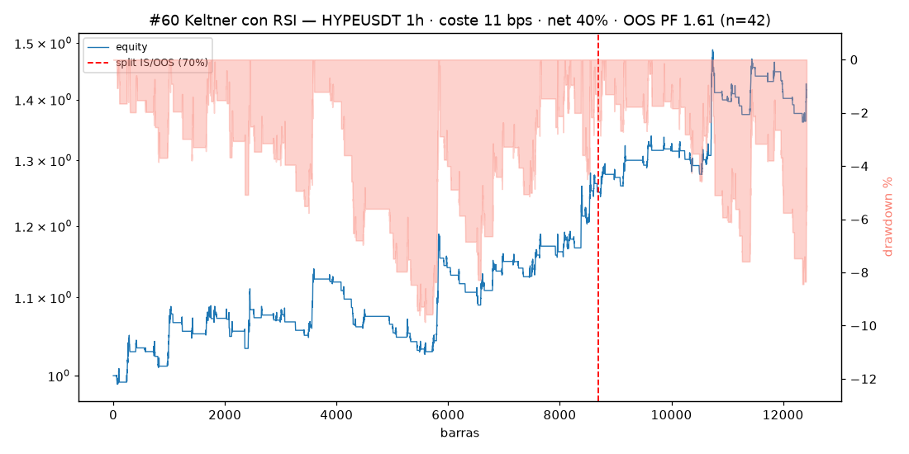
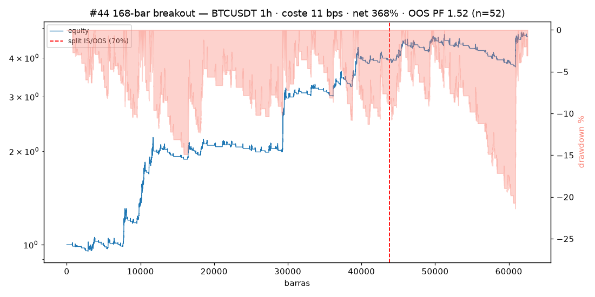
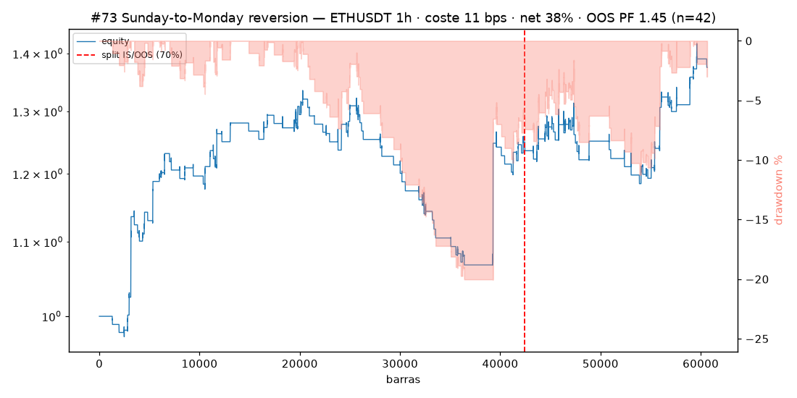
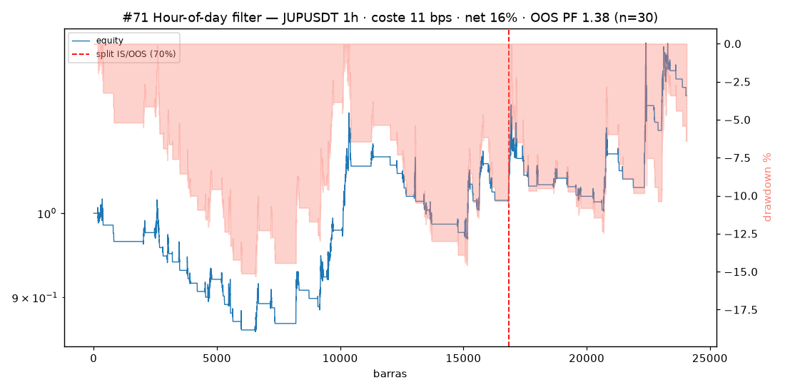
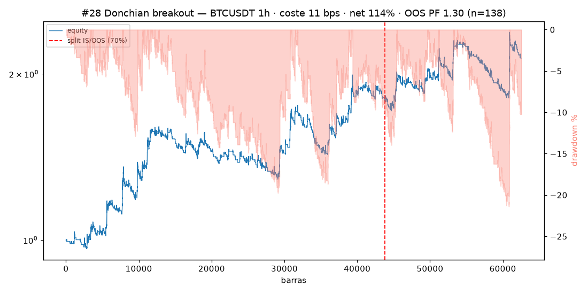
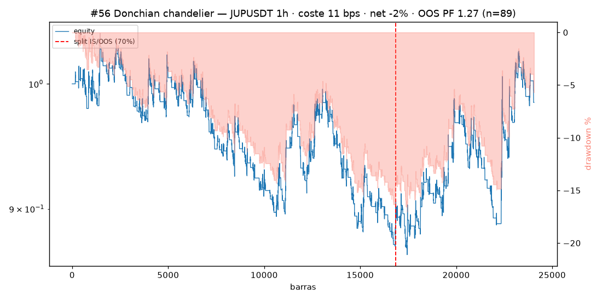
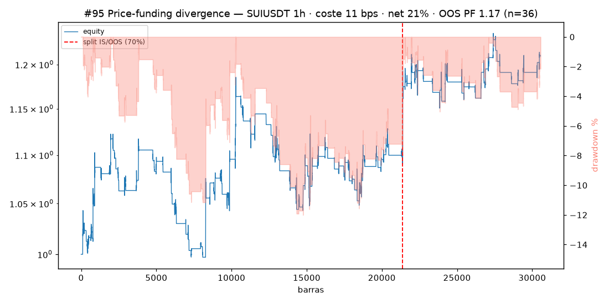
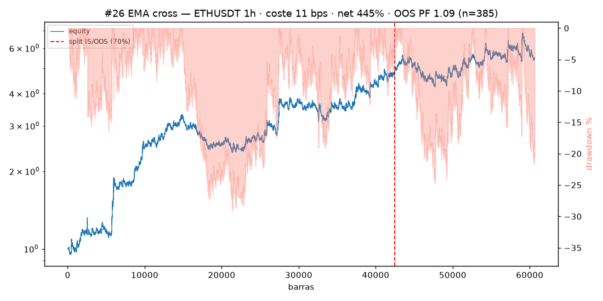
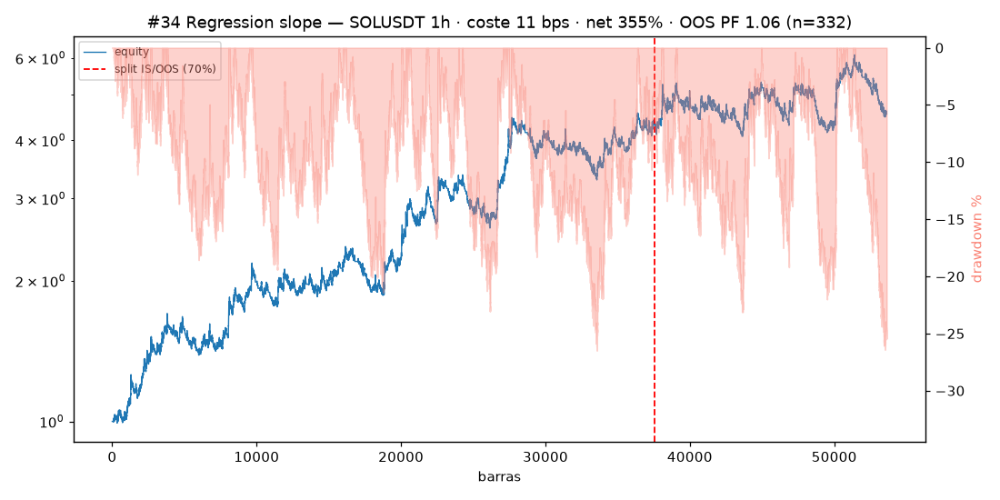
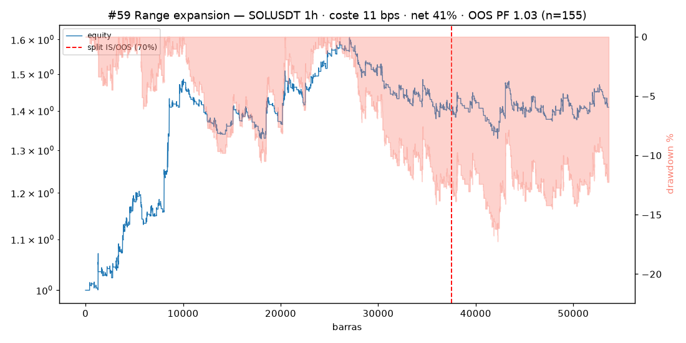

# Top 10 estrategias — criba de los 100 prompts (Binance USDT-M perps)

**Fecha:** 2026-11-01 · **Coste aplicado:** 11 bps roundtrip (modelo oficial del repo: 5 bps fee + 0.5 bps slip por lado) · **Ranking:** por OOS profit factor con ≥30 trades OOS · Fuente: `backtest_prompts100/results_100.csv`

Estas 10 son las mejores de las 100 estrategias backtested. Las 5 primeras pasan el gate completo del repo (PF ex-cost > 1.2 · n ≥ 30 · net > 0) tambien en OOS; las 5 siguientes se quedan cerca y se incluyen por contexto.

## 1. Como se calculo cada estrategia

Cada prompt del documento original se traduje a una especificacion vectorizada (`strategies.py`): indicadores estandar (RSI Wilder, ATR Wilder, EMA, Keltner, regresion OLS rodante, Donchian, funding por settlement mapeado a barras). Convenciones comunes a las 10:

- **Senal en barra cerrada:** todo indicador se calcula solo con datos hasta el cierre de la barra de senal (sin lookahead).
- **Fill en la apertura siguiente:** la entrada/salida por senal se ejecuta en la apertura de la barra posterior a la senal.
- **El stop gana empates:** si en la misma barra se tocan stop y salida, ejecuta el stop.
- **Stops intrabar con hueco:** si la barra abre mas alla del stop, el fill es en la apertura (peor), no en el nivel del stop.
- **Sizing:** 1% de la equity en riesgo por trade → notional = (0.01 × equity) / distancia_del_stop; equity compuesta trade a trade. El apalancamiento implicito es 1/(stop% del precio).
- **Costes:** 11 bps roundtrip aplicados al notional en el cierre de cada trade (en unidades R: 0.0011 × precio_entrada / distancia_stop).
- **Funding (solo #95):** devengo por settlement (cada 8 h) mientras la posicion esta abierta, acreditado/cargado al R del trade.

## 2. Como se hizo el backtest

**Motor:** eventos barra a barra (`backtest_prompts100/btlib.py`), un instrumento por estrategia. Ciclo por barra: (1) devengo de funding si hay posicion, (2) salidas — senal de la barra anterior, time stop, stop intrabar (con gap-through), trailing si aplica, (3) actualizacion del trailing, (4) entradas por senal de la barra anterior, (5) marca a mercado de la equity al cierre de la barra.

**Datos** (klines 1h de `backtest-system/data`, read-only; faltantes por API publica fapi de Binance, guardados en `backtest_prompts100/data/`):

| Par | Rango 1h |
|---|---|
| BTCUSDT | 2019-09 → 2026-10-24 |
| ETHUSDT | 2019-11 → 2026-10-24 |
| SOLUSDT | 2020-09 → 2026-10-24 |
| SUIUSDT | 2023-05 → 2026-10-24 |
| HYPEUSDT | 2025-05-30 → hoy (cola por API) |
| JUPUSDT | 2024-01-31 → hoy (API) |

**Split 70/30 IS/OOS** por numero de barras de cada serie: el 30% final de barras es out-of-sample. Las metricas IS y OOS se calculan sobre los trades cuya entrada cae en cada segmento; la equity es continua.

**Metricas:** net (retorno compuesto), max drawdown sobre la curva de equity marcada a mercado por barra, profit factor = suma de R ganadores / |suma de R perdedores| (R = P&L / distancia de stop, ya neto de costes), win rate, Sharpe anualizado (√8760 en 1h), buy & hold del par y exceso = net − B&H en el mismo segmento.

**Gates del repo aplicados como criba:** PF ex-cost > 1.2 · n ≥ 30 trades · net > 0 · exceso vs B&H reportado. En OOS se exige lo mismo. 22 bps se corrio como sensibilidad pero NO decide (coste oficial confirmado: 11 bps).

**Limites:** esto es una criba con convenciones homogeneas, NO artefactos del harness `vrun.py` (sin walk-forward, sin period gates, sin neighbourhood). Un superviviente aqui es candidato a validacion formal en backtest-system, no un resultado validado. El max DD se mide en cierres de barra; los fills intrabar de stop estan modelados pero la curva solo marca al cierre.

## 3. Resumen de las 10 (11 bps)

| # | Estrategia | Par · TF | Net | PF | n | DD | WR | OOS PF | OOS n | OOS net | OOS DD | Exceso OOS | Gate |
|---|---|---|---|---|---|---|---|---|---|---|---|---|---|
| 60 | Keltner con RSI | HYPE · 1h | +40.3% | 1.60 | 128 | -9.9% | 37% | 1.61 | 42 | +12.2% | -8.4% | -40pp | ✅ completo |
| 44 | 168-bar breakout | BTC · 1h | +368.0% | 2.54 | 161 | -21.4% | 28% | 1.52 | 52 | +18.7% | -21.4% | -25pp | ✅ completo |
| 73 | Sunday-to-Monday reversion | ETH · 1h | +37.5% | 1.45 | 128 | -20.1% | 41% | 1.45 | 42 | +10.0% | -9.8% | +22pp | ✅ completo |
| 71 | Hour-of-day filter | JUP · 1h | +15.8% | 1.26 | 97 | -15.3% | 23% | 1.38 | 30 | +12.5% | -12.5% | -15pp | ✅ completo |
| 28 | Donchian breakout | BTC · 1h | +113.7% | 1.37 | 430 | -21.4% | 33% | 1.30 | 138 | +19.2% | -21.4% | -25pp | ✅ completo |
| 56 | Donchian chandelier | JUP · 1h | -1.6% | 1.01 | 299 | -17.0% | 35% | 1.27 | 89 | +11.7% | -10.1% | -16pp | — |
| 95 | Price-funding divergence | SUI · 1h | +21.0% | 1.25 | 153 | -12.0% | 43% | 1.17 | 36 | +1.4% | -5.0% | +65pp | full |
| 26 | EMA cross | ETH · 1h | +444.7% | 1.36 | 1134 | -29.1% | 27% | 1.09 | 385 | +15.6% | -24.8% | +28pp | full |
| 34 | Regression slope | SOL · 1h | +355.0% | 1.26 | 1096 | -26.5% | 29% | 1.06 | 332 | +4.8% | -26.4% | +51pp | full |
| 59 | Range expansion | SOL · 1h | +40.9% | 1.25 | 533 | -17.3% | 39% | 1.03 | 155 | +0.9% | -8.3% | +47pp | full |

---

## #60 Keltner con RSI — HYPE · 1h

**Keltner breakout con confirmacion de RSI** (HYPE 1h). Compra rupturas de volatilidad solo cuando el impulso acompana: precio que cierra fuera del canal Keltner superior y RSI en zona alcista. Es la unica del lote de rupturas con filtro de momento.

**Reglas exactas (tal como se backtestearon):**

- **Entrada (long):** close > canal Keltner superior, con Keltner(20, 2.0) = EMA(20) ± 2×ATR(20); ademas RSI(14) > 60. Senal al cierre; fill en la apertura siguiente.
- **Salida:** close < EMA(20) (senal al cierre, fill en la apertura siguiente).
- **Stop:** 2×ATR(14) por debajo del precio de entrada, estatico.
- **Direccion:** solo long.

**Ventana:** 2025-05-30 → 2026-10-29 (12,421 barras 1h) · **OOS desde:** 2026-05-27

**Resultados (11 bps):** net +40.3% · PF 1.60 · n 128 · DD -9.9% · WR 37% · Sharpe 1.52 · B&H +176% — OOS: net +12.2% · PF 1.61 · n 42 · DD -8.4% · Sharpe 1.53 · exceso vs B&H -40pp

**Nota:** Datos HYPE 1h desde 2025-05-30 (listing del perp), completado por API hasta hoy. El OOS alcista de HYPE hace que B&H gane +40pp a la estrategia; el PF se mantiene incluso a 22 bps (OOS 1.47).

---

## #44 168-bar breakout — BTC · 1h

**Ruptura de rango largo (7 dias)** (BTC 1h). Canales de Donchian asimetricos tipo turtle: entrada cuando el close supera el maximo de 168 horas, salida cuando cae bajo el minimo de 72 horas. Estrategia de tendencia pura, sin indicador.

**Reglas exactas (tal como se backtestearon):**

- **Entrada (long):** close > maximo de las 168 barras anteriores (rolling 168 desplazado 1 barra; ~7 dias).
- **Salida:** close < minimo de las 72 barras anteriores (~3 dias).
- **Stop:** 2.5×ATR(14) bajo la entrada, estatico.
- **Direccion:** solo long.

**Ventana:** 2019-09-08 → 2026-10-27 (62,548 barras 1h) · **OOS desde:** 2024-09-06

**Resultados (11 bps):** net +368.0% · PF 2.54 · n 161 · DD -21.4% · WR 28% · Sharpe 1.29 · B&H +708% — OOS: net +18.7% · PF 1.52 · n 52 · DD -21.4% · Sharpe 0.61 · exceso vs B&H -25pp

**Nota:** La #44 del doc original ('168-bar breakout') era la mas viva de la criba prompts-100 de 2026-10-30 y aqui confirma: gate completo + OOS + sensibilidad 22 bps (OOS 1.39).

---

## #73 Sunday-to-Monday reversion — ETH · 1h

**Reversion de domingo a lunes** (ETH 1h). Si el domingo cerro con una caida mayor que 1 ATR, compra la apertura del lunes y mantiene ~48 h. Apuesta al rebote posterior a un fin de semana debil. La unica del top que bate a buy & hold en OOS con gate completo.

**Reglas exactas (tal como se backtestearon):**

- **Senal:** el retorno del domingo (close de la barra de las 23:00 UTC menos la apertura de las 00:00 UTC) es menor que −1×ATR(14).
- **Entrada (long):** fill en la apertura del lunes 00:00 UTC.
- **Salida:** senal el lunes 23:00 UTC → fill en la apertura del martes 00:00 UTC (hold ≈ 48 h). Tambien cierra por stop.
- **Stop:** 2×ATR(14) bajo la entrada, estatico.
- **Direccion:** solo long.

**Ventana:** 2019-11-27 → 2026-10-27 (60,638 barras 1h) · **OOS desde:** 2024-09-29

**Resultados (11 bps):** net +37.5% · PF 1.45 · n 128 · DD -20.1% · WR 41% · Sharpe 0.65 · B&H +1505% — OOS: net +10.0% · PF 1.45 · n 42 · DD -9.8% · Sharpe 0.62 · exceso vs B&H +22pp

**Nota:** Apuesta al rebote posterior a un fin de semana debil. Es la unica del top que bate a B&H en OOS con gate completo (+22pp). Muestra pequena (42 OOS): validar antes de creer.

---

## #71 Hour-of-day filter — JUP · 1h

**EMA cross restringido a hora del dia** (JUP 1h). El cruce clasico EMA20/EMA50 pero solo aceptando senales generadas entre las 14:00 y 17:59 UTC (apertura de EU/US). Reduce los falsos cruces del resto del dia en un altcoin ruidoso.

**Reglas exactas (tal como se backtestearon):**

- **Entrada (long):** EMA(20) cruza por encima de EMA(50) y la hora de la barra de senal es 14, 15, 16 o 17 UTC. **Entrada (short):** cruce inverso en la misma ventana.
- **Salida:** cruce contrario en cualquier hora del dia.
- **Stop:** 2×ATR(14) contra la entrada, estatico.
- **Direccion:** long y short.

**Ventana:** 2024-01-31 → 2026-10-29 (24,053 barras 1h) · **OOS desde:** 2026-01-02

**Resultados (11 bps):** net +15.8% · PF 1.26 · n 97 · DD -15.3% · WR 23% · Sharpe 0.44 · B&H -62% — OOS: net +12.5% · PF 1.38 · n 30 · DD -12.5% · Sharpe 0.87 · exceso vs B&H -15pp

**Nota:** JUP 1h viene de la API (listing del perp 2024-01-31). Solo 30 trades OOS: en el limite del gate. Aguanta 22 bps (OOS 1.31).

---

## #28 Donchian breakout — BTC · 1h

**Donchian breakout clasico** (BTC 1h). Entra cuando el close rompe el maximo de 55 barras (~2.3 dias) y sale cuando cae bajo el minimo de 20 barras. El mas antiguo del top y el que tiene mas trades OOS (138): la senal de tendencia mas robusta del lote.

**Reglas exactas (tal como se backtestearon):**

- **Entrada (long):** close > maximo de las 55 barras anteriores (desplazado 1 barra; ~2.3 dias).
- **Salida:** close < minimo de las 20 barras anteriores.
- **Stop:** 3×ATR(14) bajo la entrada, estatico.
- **Direccion:** solo long.

**Ventana:** 2019-09-08 → 2026-10-27 (62,548 barras 1h) · **OOS desde:** 2024-09-06

**Resultados (11 bps):** net +113.7% · PF 1.37 · n 430 · DD -21.4% · WR 33% · Sharpe 0.79 · B&H +708% — OOS: net +19.2% · PF 1.30 · n 138 · DD -21.4% · Sharpe 0.62 · exceso vs B&H -25pp

**Nota:** El mas robusto por muestra (138 trades OOS) y el mas viejo del lote. Es el unico del top que NO aguanta la sensibilidad de 22 bps (OOS PF cae a 1.16).

---

## #56 Donchian chandelier — JUP · 1h

**Donchian con salida chandelier** (JUP 1h). Entra por ruptura del maximo de 30 barras y deja correr la ganancia con un stop movil tipo chandelier (maximo desde entrada menos 3 ATR). Sin salida discreta: todo el exit es el trail.

**Reglas exactas (tal como se backtestearon):**

- **Entrada (long):** close > maximo de las 30 barras anteriores (desplazado 1 barra).
- **Salida:** stop movil chandelier: stop = max(stop, high de la barra − 3×ATR(14)), actualizado en cada barra mientras la posicion esta abierta. No hay salida por senal.
- **Stop inicial:** 3×ATR(14) bajo la entrada (es tambien la distancia de sizing).
- **Direccion:** solo long.

**Ventana:** 2024-01-31 → 2026-10-29 (24,053 barras 1h) · **OOS desde:** 2026-01-02

**Resultados (11 bps):** net -1.6% · PF 1.01 · n 299 · DD -17.0% · WR 35% · Sharpe 0.02 · B&H -62% — OOS: net +11.7% · PF 1.27 · n 89 · DD -10.1% · Sharpe 1.02 · exceso vs B&H -16pp

**Nota:** No pasa el gate completo (net total −1.6%: el IS lo pierde) pero su OOS es sólido (PF 1.27, +11.7%). Candidato solo si el IS se descarta como regime distinto.

---

## #95 Price-funding divergence — SUI · 1h

**Divergencia precio-funding** (SUI 1h). Short cuando el precio hace un nuevo minimo de 48 barras mientras el funding esta en su maximo de ~30 settlements: multitud pagando funding alto justo en el suelo. Time stop de 24 barras; el short cobra el funding positivo mientras dura la posicion.

**Reglas exactas (tal como se backtestearon):**

- **Senal (short):** close ≤ minimo de las 48 barras anteriores (nuevo minimo) Y funding actual ≥ maximo del funding de las ultimas ~30 settlements (8 h cada uno).
- **Entrada:** fill en la apertura siguiente al cierre de la barra de senal.
- **Salida:** time stop a las 24 barras (fill en la apertura de la barra 25) o stop.
- **Stop:** 2×ATR(14) sobre la entrada, estatico.
- **Funding:** el short cobra (+rate × notional) en cada settlement que atraviesa; se acredita en el R del trade.
- **Direccion:** solo short.

**Ventana:** 2023-05-03 → 2026-10-27 (30,557 barras 1h) · **OOS desde:** 2025-10-10

**Resultados (11 bps):** net +21.0% · PF 1.25 · n 153 · DD -12.0% · WR 43% · Sharpe 0.55 · B&H -33% — OOS: net +1.4% · PF 1.17 · n 36 · DD -5.0% · Sharpe 0.20 · exceso vs B&H +65pp

**Nota:** Exceso vs B&H en OOS +65pp: gana al activo con claridad. OOS PF 1.17 queda bajo el gate 1.2 — a la espera de validacion formal. Requiere feed de funding en vivo.

---

## #26 EMA cross — ETH · 1h

**Cruce de medias EMA20/50** (ETH 1h). El trend-following canonico, long y short, salida por cruce contrario y stop amplio de 3 ATR. 1134 trades: el de mayor muestra del top; su OOS PF 1.09 es marginal pero el exceso vs B&H es positivo.

**Reglas exactas (tal como se backtestearon):**

- **Entrada (long):** EMA(20) cruza por encima de EMA(50). **Entrada (short):** EMA(20) cruza por debajo de EMA(50).
- **Salida:** cruce contrario.
- **Stop:** 3×ATR(14) contra la entrada, estatico.
- **Direccion:** long y short.

**Ventana:** 2019-11-27 → 2026-10-27 (60,638 barras 1h) · **OOS desde:** 2024-09-29

**Resultados (11 bps):** net +444.7% · PF 1.36 · n 1134 · DD -29.1% · WR 27% · Sharpe 1.07 · B&H +1505% — OOS: net +15.6% · PF 1.09 · n 385 · DD -24.8% · Sharpe 0.41 · exceso vs B&H +28pp

**Nota:** Mayor muestra del top (1134 trades, 385 OOS). El OOS PF 1.09 no pasa el gate y a 22 bps cae a 1.00: edge real pero comido por el coste.

---

## #34 Regression slope — SOL · 1h

**Pendiente de regresion lineal** (SOL 1h). Pendiente OLS de los ultimos 50 closes; long cuando la pendiente cruza a positivo, short cuando cruza a negativo. Version suavizada del momentum que filtra mejor el ruido que un cruce de medias corto.

**Reglas exactas (tal como se backtestearon):**

- **Senal:** pendiente de la regresion lineal (minimos cuadrados, formula cerrada con sumas rodantes) de los ultimos 50 closes.
- **Entrada (long):** la pendiente cruza de ≤0 a >0. **Entrada (short):** cruza de ≥0 a <0.
- **Salida:** cruce de pendiente contrario.
- **Stop:** 2×ATR(14) contra la entrada, estatico.
- **Direccion:** long y short.

**Ventana:** 2020-09-14 → 2026-10-27 (53,630 barras 1h) · **OOS desde:** 2024-12-26

**Resultados (11 bps):** net +355.0% · PF 1.26 · n 1096 · DD -26.5% · WR 29% · Sharpe 0.95 · B&H +2900% — OOS: net +4.8% · PF 1.06 · n 332 · DD -26.4% · Sharpe 0.24 · exceso vs B&H +51pp

**Nota:** Exceso vs B&H OOS +51pp (bate al activo). OOS PF 1.06 marginal; a 22 bps cae a 0.98.

---

## #59 Range expansion — SOL · 1h

**Expansion de rango intrabar** (SOL 1h). Compra velas cuya amplitud dobla al ATR y que ademas cierran en el 20% superior de la propia vela (momento de cierre). Stop en el minimo de la vela de senal y salida si el close cae bajo el minimo previo.

**Reglas exactas (tal como se backtestearon):**

- **Senal (long):** rango de la barra (high−low) > 2×ATR(14) Y el close esta en el 20% superior de la propia vela ((close−low)/(high−low) > 0.8).
- **Entrada:** fill en la apertura siguiente al cierre de la vela de senal.
- **Stop:** el minimo de la vela de senal (distancia de sizing = close − low).
- **Salida:** senal al cierre cuando close < minimo de la barra anterior.
- **Direccion:** solo long.

**Ventana:** 2020-09-14 → 2026-10-27 (53,630 barras 1h) · **OOS desde:** 2024-12-26

**Resultados (11 bps):** net +40.9% · PF 1.25 · n 533 · DD -17.3% · WR 39% · Sharpe 0.69 · B&H +2900% — OOS: net +0.9% · PF 1.03 · n 155 · DD -8.3% · Sharpe 0.10 · exceso vs B&H +47pp

**Nota:** Exceso vs B&H OOS +47pp. OOS PF 1.03: practicamente break-even en OOS.

---

**Veredicto:** las 5 con gate completo + OOS (#60 #44 #73 #71 #28) son candidatos a validacion formal en backtest-system (`vrun.py`, walk-forward). Orden sugerido por robustez de muestra: #28 (138 OOS) → #44 (52) → #60 (42) ≈ #73 (42) → #71 (30). #95 es el mas interesante por exceso vs B&H (+65pp) pero su OOS PF 1.17 no llega al gate; #26/#34/#59 tienen exceso positivo y PF OOS marginal. Las reversion a la media, los pares y todo el rango 5m/15m de la criba quedaron muertos (ver REPORT.md).